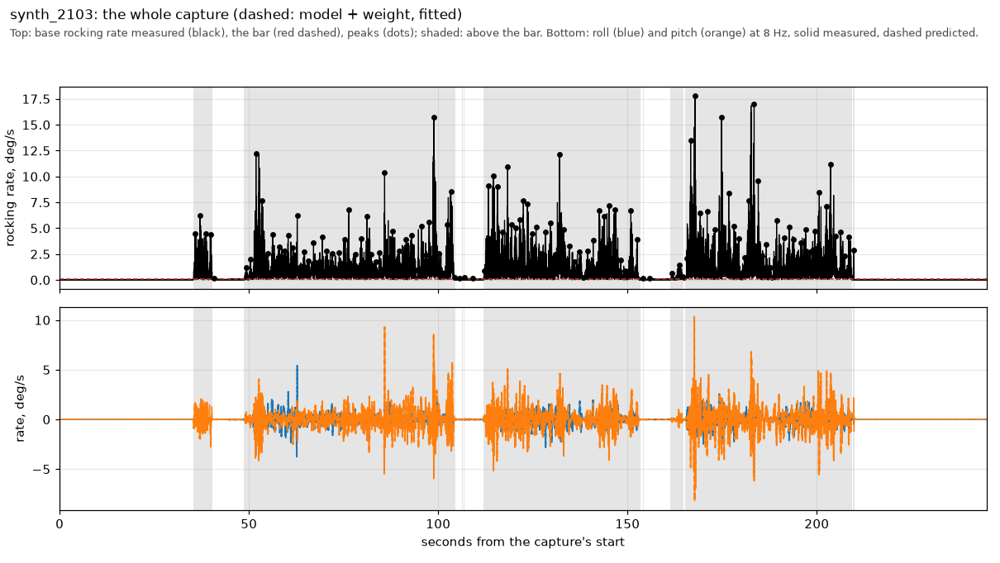
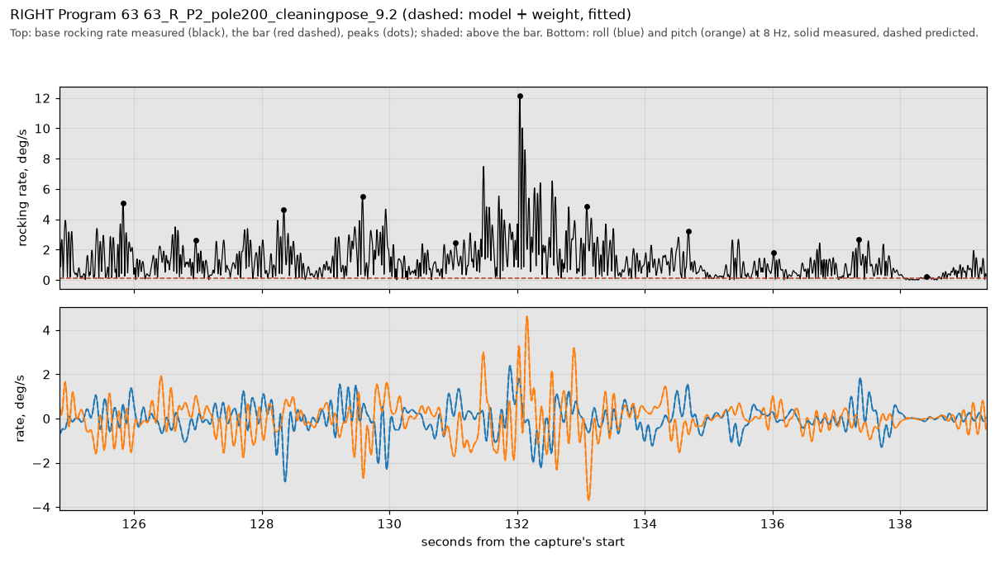

# IMU against the arms: synth_2103

**MADE-UP CAPTURE** (`tools/imu_runs.py synth`): this tests the analysis; it measures nothing.

- Capture: 97,864 IMU frames at 400.0 per second, 47 lost, 0 damaged; 244.8 s.
- Clocks: the sensor's runs +30.1 ppm against the laptop's; frames reach the laptop 5.1 ms (median) and 11.4 ms (99 %) after the earliest.
- Gyro bias (base axes, deg/s): start +0.203 -0.102 +0.048; end +0.238 -0.119 +0.050; from the first and last 30 s.
- Gravity at rest in base axes (m/s^2): +0.00 +0.00 +9.81. With the mount right it is about 0 0 +9.81; anything else means --mount (180,0,0) is wrong.
- Noise floor 0.0249 deg/s RMS, from the run's quietest seconds (no --floor given: a step C capture is better); the bar is 5 x that: 0.1247 deg/s.
- Low-pass 30 Hz for the peaks, 8 Hz for the model check.

## Does Lite's model predict the rocking?

| Prediction | Axis | Lag, ms (IMU later +) | Gain, deg per N m | Share explained (R^2) |
|---|---|---|---|---|
| model | roll | +60 | 0.02198 | 0.944 |
| model | pitch | +60 | -0.03097 | 0.958 |
| model + weight | roll | +60 | 0.01983 | 0.998 |
| model + weight | pitch | +60 | -0.02965 | 0.998 |

"model" is the dynamic load Lite's optimiser limits; "model + weight" adds the arm's weight moving over the base, which the model leaves out. Each is compared as its rate of change; the gain is the tilt per newton metre (its sign follows the axes). Pole moves are not modelled: the model holds the pole still.

## Program runs

| Arm | Program | File | Match, deg | Note |
|---|---|---|---|---|
| LEFT | Program 61 61_L_P1_pole50_cleaningpose_48.2 | 61_L_P1_pole50_cleaningpose_48.2s_20pct_steady30s_plus20.txt | 0.30 | - |
| RIGHT | Program 61 61_R_P1_pole200_cleaningpose_53. | 61_R_P1_pole200_cleaningpose_53.5s_20pct_steady40s.txt | 0.28 | - |
| LEFT | Program 62 62_L_P2_pole200_cleaningpose_22. | 62_L_P2_pole200_cleaningpose_22.6s_30pct.txt | 0.29 | - |
| RIGHT | Program 62 62_R_P2_pole200_grip_13.0s_new_R | 62_R_P2_pole200_grip_13.0s_new_R04.txt | 0.20 | - |
| RIGHT | Program 63 63_R_P2_pole200_cleaningpose_9.2 | 63_R_P2_pole200_cleaningpose_9.2s_30pct.txt | 0.39 | - |
| LEFT | Program 63 63_L_P2_pole200_grip_10.5s_25pct | 63_L_P2_pole200_grip_10.5s_25pct_new_slowstart.txt | 0.26 | - |
| RIGHT | Program 64 64_1_R_P2_pole50_cleaningpose_10 | 64_1_R_P2_pole50_cleaningpose_10.4s_new_R06.txt | 0.22 | - |
| RIGHT | Program 65 65_R_P3_pole50_grip_39.8s_new_R0 | 65_R_P3_pole50_grip_39.8s_new_R07_R08P2_30pct_slowstart.txt | 0.29 | - |
| LEFT | Program 64 64_L_P3_pole200_cleaningpose_19. | 64_L_P3_pole200_cleaningpose_19.8s_25pct_slow10-15s.txt | 0.44 | - |
| LEFT | Program 65 65_L_P3_pole200_grip_45.3s_smoot (ended early) | 65_L_P3_pole200_grip_45.3s_smooth_noidle_faster.txt | 0.29 | - |

Match: how far the feed's joints are from the file's matched lines (median, all joints).

## Peaks above the bar (123; the 20 strongest here, in time order; all in sections.csv)

| Time s | Peak deg/s | Roll, pitch | Above the bar from s, for s | Horiz. acc m/s^2 | Jerk m/s^3 | At 8 Hz, deg/s: measured, model, model + weight | LEFT step | RIGHT step | Lines (+-0.25 s) | In the file |
|---|---|---|---|---|---|---|---|---|---|---|
| 51.85 | 12.186 | -6.905, -10.041 | 48.69, 55.81 | 0.011 | 1.22 | 4.658, 4.473, 4.657 | Program 61 61_L_P1_pole50_cleaningpose_48.2 | Program 61 61_R_P1_pole200_cleaningpose_53. | LEFT 61_L_P1_pole50_cleaningpose_48.2s_20pct_steady30s_plus20.txt lines 134-233; RIGHT 61_R_P1_pole200_cleaningpose_53.5s_20pct_steady40s.txt lines 332-429 | LEFT: most acceleration J7 139 deg/s^2, most jerk J5 1544 deg/s^3; RIGHT: most acceleration J6 360 deg/s^2, most jerk J6 3465 deg/s^3, turns back: J6 |
| 53.46 | 7.688 | -2.095, +7.397 | 48.69, 55.81 | 0.011 | 1.12 | 3.365, 3.570, 3.431 | Program 61 61_L_P1_pole50_cleaningpose_48.2 | Program 61 61_R_P1_pole200_cleaningpose_53. | LEFT 61_L_P1_pole50_cleaningpose_48.2s_20pct_steady30s_plus20.txt lines 452-549; RIGHT 61_R_P1_pole200_cleaningpose_53.5s_20pct_steady40s.txt lines 649-749 | LEFT: most acceleration J3 331 deg/s^2, most jerk J3 11273 deg/s^3, turns back: J7; RIGHT: most acceleration J6 205 deg/s^2, most jerk J2 3056 deg/s^3, turns back: J6 |
| 85.83 | 10.377 | +2.037, +10.175 | 48.69, 55.81 | 0.013 | 1.65 | 9.443, 9.734, 9.407 | Program 61 61_L_P1_pole50_cleaningpose_48.2 | Program 61 61_R_P1_pole200_cleaningpose_53. | LEFT 61_L_P1_pole50_cleaningpose_48.2s_20pct_steady30s_plus20.txt lines 6777-6875; RIGHT 61_R_P1_pole200_cleaningpose_53.5s_20pct_steady40s.txt lines 7003-7102 | LEFT: most acceleration J1 1108 deg/s^2, most jerk J6 34496 deg/s^3, turns back: J3 J4 J6; RIGHT: most acceleration J6 502 deg/s^2, most jerk J6 7831 deg/s^3, turns back: J2 J3 J5 J6 J7 |
| 98.85 | 15.755 | -1.598, -15.674 | 48.69, 55.81 | 0.011 | 1.20 | 8.506, 8.280, 8.623 | Program 61 61_L_P1_pole50_cleaningpose_48.2 | Program 61 61_R_P1_pole200_cleaningpose_53. | LEFT 61_L_P1_pole50_cleaningpose_48.2s_20pct_steady30s_plus20.txt lines 9330-9429; RIGHT 61_R_P1_pole200_cleaningpose_53.5s_20pct_steady40s.txt lines 9561-9660 | LEFT: most acceleration J4 448 deg/s^2, most jerk J4 5041 deg/s^3, turns back: J4 J6; RIGHT: most acceleration J7 608 deg/s^2, most jerk J7 7622 deg/s^3, turns back: J3 J4 J6 J7 |
| 103.33 | 8.506 | +1.966, -8.276 | 48.69, 55.81 | 0.015 | 1.60 | 4.197, 4.101, 4.181 | WAIT | Program 61 61_R_P1_pole200_cleaningpose_53. | RIGHT 61_R_P1_pole200_cleaningpose_53.5s_20pct_steady40s.txt lines 10440-10533 | RIGHT: most acceleration J5 513 deg/s^2, most jerk J7 5463 deg/s^3, turns back: J6 J7 |
| 113.21 | 9.116 | -1.434, -9.002 | 111.89, 41.45 | 0.009 | 0.84 | 2.501, 2.294, 2.502 | Program 62 62_L_P2_pole200_cleaningpose_22. | Program 62 62_R_P2_pole200_grip_13.0s_new_R | LEFT 62_L_P2_pole200_cleaningpose_22.6s_30pct.txt lines 190-289; RIGHT 62_R_P2_pole200_grip_13.0s_new_R04.txt lines 278-378 | LEFT: most acceleration J4 44 deg/s^2, most jerk J4 849 deg/s^3; RIGHT: most acceleration J6 282 deg/s^2, most jerk J3 1672 deg/s^3, turns back: J4 J5 J7 |
| 114.57 | 10.072 | -0.513, -10.059 | 111.89, 41.45 | 0.011 | 1.41 | 5.172, 5.205, 5.149 | Program 62 62_L_P2_pole200_cleaningpose_22. | Program 62 62_R_P2_pole200_grip_13.0s_new_R | LEFT 62_L_P2_pole200_cleaningpose_22.6s_30pct.txt lines 454-549; RIGHT 62_R_P2_pole200_grip_13.0s_new_R04.txt lines 549-647 | LEFT: most acceleration J6 466 deg/s^2, most jerk J6 6001 deg/s^3, turns back: J6; RIGHT: most acceleration J6 210 deg/s^2, most jerk J6 2684 deg/s^3, turns back: J7 |
| 115.73 | 9.026 | +0.608, -9.006 | 111.89, 41.45 | 0.012 | 1.50 | 4.218, 4.081, 4.164 | Program 62 62_L_P2_pole200_cleaningpose_22. | Program 62 62_R_P2_pole200_grip_13.0s_new_R | LEFT 62_L_P2_pole200_cleaningpose_22.6s_30pct.txt lines 681-780; RIGHT 62_R_P2_pole200_grip_13.0s_new_R04.txt lines 775-875 | LEFT: most acceleration J6 508 deg/s^2, most jerk J6 4156 deg/s^3, turns back: J1 J3 J5 J6; RIGHT: most acceleration J2 244 deg/s^2, most jerk J4 2360 deg/s^3, turns back: J3 J4 J5 J6 |
| 118.33 | 10.918 | -2.042, +10.725 | 111.89, 41.45 | 0.010 | 1.24 | 5.197, 4.835, 5.160 | Program 62 62_L_P2_pole200_cleaningpose_22. | Program 62 62_R_P2_pole200_grip_13.0s_new_R | LEFT 62_L_P2_pole200_cleaningpose_22.6s_30pct.txt lines 1195-1292; RIGHT 62_R_P2_pole200_grip_13.0s_new_R04.txt lines 1290-1388 | LEFT: most acceleration J6 654 deg/s^2, most jerk J6 5693 deg/s^3, turns back: J2 J3 J4 J6; RIGHT: most acceleration J4 368 deg/s^2, most jerk J4 3852 deg/s^3, turns back: J4 J6 |
| 122.48 | 7.649 | +0.024, -7.649 | 111.89, 41.45 | 0.011 | 1.02 | 2.899, 3.000, 2.886 | Program 62 62_L_P2_pole200_cleaningpose_22. | Program 62 62_R_P2_pole200_grip_13.0s_new_R | LEFT 62_L_P2_pole200_cleaningpose_22.6s_30pct.txt lines 2005-2106; RIGHT 62_R_P2_pole200_grip_13.0s_new_R04.txt lines 2106-2205 | LEFT: most acceleration J6 626 deg/s^2, most jerk J6 6106 deg/s^3, turns back: J2 J3 J4 J5 J6; RIGHT: most acceleration J6 344 deg/s^2, most jerk J4 3767 deg/s^3 |
| 132.04 | 12.153 | +3.836, +11.532 | 111.89, 41.45 | 0.013 | 1.12 | 4.612, 4.208, 4.616 | Program 62 62_L_P2_pole200_cleaningpose_22. | Program 63 63_R_P2_pole200_cleaningpose_9.2 | LEFT 62_L_P2_pole200_cleaningpose_22.6s_30pct.txt lines 3872-3971; RIGHT 63_R_P2_pole200_cleaningpose_9.2s_30pct.txt lines 584-683 | LEFT: most acceleration J1 298 deg/s^2, most jerk J1 2565 deg/s^3, turns back: J1 J3; RIGHT: most acceleration J5 441 deg/s^2, most jerk J5 4931 deg/s^3, turns back: J4 J5 J6 J7 |
| 166.66 | 13.478 | -1.302, -13.415 | 165.14, 44.20 | 0.009 | 0.95 | 4.874, 4.622, 4.811 | Program 64 64_L_P3_pole200_cleaningpose_19. | Program 65 65_R_P3_pole50_grip_39.8s_new_R0 | RIGHT 65_R_P3_pole50_grip_39.8s_new_R07_R08P2_30pct_slowstart.txt lines 349-446; LEFT 64_L_P3_pole200_cleaningpose_19.8s_25pct_slow10-15s.txt lines 254-353 | RIGHT: most acceleration J5 40 deg/s^2, most jerk J6 579 deg/s^3; LEFT: most acceleration J6 904 deg/s^2, most jerk J6 7696 deg/s^3, turns back: J5 J6 J7 |
| 167.83 | 17.810 | +1.763, -17.723 | 165.14, 44.20 | 0.013 | 1.29 | 10.370, 11.037, 10.322 | Program 64 64_L_P3_pole200_cleaningpose_19. | Program 65 65_R_P3_pole50_grip_39.8s_new_R0 | RIGHT 65_R_P3_pole50_grip_39.8s_new_R07_R08P2_30pct_slowstart.txt lines 579-674; LEFT 64_L_P3_pole200_cleaningpose_19.8s_25pct_slow10-15s.txt lines 482-583 | RIGHT: most acceleration J4 231 deg/s^2, most jerk J4 1492 deg/s^3, turns back: J3 J4 J6; LEFT: most acceleration J6 856 deg/s^2, most jerk J6 13596 deg/s^3, turns back: J1 J7 |
| 174.82 | 15.762 | -0.507, +15.754 | 165.14, 44.20 | 0.012 | 0.97 | 3.907, 4.203, 3.910 | Program 64 64_L_P3_pole200_cleaningpose_19. | Program 65 65_R_P3_pole50_grip_39.8s_new_R0 | RIGHT 65_R_P3_pole50_grip_39.8s_new_R07_R08P2_30pct_slowstart.txt lines 1952-2050; LEFT 64_L_P3_pole200_cleaningpose_19.8s_25pct_slow10-15s.txt lines 1857-1956 | RIGHT: most acceleration J4 409 deg/s^2, most jerk J4 3995 deg/s^3, turns back: J2 J3 J4 J5 J6 J7; LEFT: most acceleration J6 769 deg/s^2, most jerk J1 8503 deg/s^3, turns back: J1 J2 J3 J5 J6 |
| 176.72 | 8.417 | -1.158, +8.336 | 165.14, 44.20 | 0.012 | 1.11 | 3.037, 3.250, 3.031 | Program 64 64_L_P3_pole200_cleaningpose_19. | Program 65 65_R_P3_pole50_grip_39.8s_new_R0 | RIGHT 65_R_P3_pole50_grip_39.8s_new_R07_R08P2_30pct_slowstart.txt lines 2325-2425; LEFT 64_L_P3_pole200_cleaningpose_19.8s_25pct_slow10-15s.txt lines 2232-2331 | RIGHT: most acceleration J6 550 deg/s^2, most jerk J4 6227 deg/s^3, turns back: J2 J5 J6; LEFT: most acceleration J6 389 deg/s^2, most jerk J5 2718 deg/s^3, turns back: J3 J4 J5 J6 |
| 181.95 | 7.634 | +3.945, +6.536 | 165.14, 44.20 | 0.012 | 1.11 | 1.056, 1.246, 1.048 | Program 64 64_L_P3_pole200_cleaningpose_19. | Program 65 65_R_P3_pole50_grip_39.8s_new_R0 | RIGHT 65_R_P3_pole50_grip_39.8s_new_R07_R08P2_30pct_slowstart.txt lines 3350-3433; LEFT 64_L_P3_pole200_cleaningpose_19.8s_25pct_slow10-15s.txt lines 3260-3359 | RIGHT: most acceleration J6 438 deg/s^2, most jerk J6 5609 deg/s^3, turns back: J5 J6; LEFT: most acceleration J5 173 deg/s^2, most jerk J6 1330 deg/s^3 |
| 183.43 | 17.009 | -2.842, -16.770 | 165.14, 44.20 | 0.011 | 1.06 | 6.348, 6.002, 6.274 | Program 64 64_L_P3_pole200_cleaningpose_19. | Program 65 65_R_P3_pole50_grip_39.8s_new_R0 | RIGHT 65_R_P3_pole50_grip_39.8s_new_R07_R08P2_30pct_slowstart.txt lines 3623-3719; LEFT 64_L_P3_pole200_cleaningpose_19.8s_25pct_slow10-15s.txt lines 3555-3654 | RIGHT: most acceleration J6 406 deg/s^2, most jerk J6 3702 deg/s^3, turns back: J2 J4 J5 J6; LEFT: most acceleration J6 724 deg/s^2, most jerk J5 6479 deg/s^3, turns back: J5 J6 |
| 184.52 | 9.579 | +0.366, -9.572 | 165.14, 44.20 | 0.011 | 0.98 | 3.612, 3.096, 3.578 | Program 64 64_L_P3_pole200_cleaningpose_19. | Program 65 65_R_P3_pole50_grip_39.8s_new_R0 | RIGHT 65_R_P3_pole50_grip_39.8s_new_R07_R08P2_30pct_slowstart.txt lines 3839-3937; LEFT 64_L_P3_pole200_cleaningpose_19.8s_25pct_slow10-15s.txt lines 3769-3865 | RIGHT: most acceleration J6 524 deg/s^2, most jerk J6 3903 deg/s^3, turns back: J1 J2 J4 J5 J6 J7; LEFT: most acceleration J6 749 deg/s^2, most jerk J6 9985 deg/s^3, turns back: J2 J4 |
| 200.64 | 8.446 | -1.698, -8.273 | 165.14, 44.20 | 0.013 | 1.02 | 5.600, 5.661, 5.615 | Program 65 65_L_P3_pole200_grip_45.3s_smoot (ended early) | Program 65 65_R_P3_pole50_grip_39.8s_new_R0 | RIGHT 65_R_P3_pole50_grip_39.8s_new_R07_R08P2_30pct_slowstart.txt lines 6996-7094; LEFT 65_L_P3_pole200_grip_45.3s_smooth_noidle_faster.txt lines 2112-2210 | RIGHT: most acceleration J4 119 deg/s^2, most jerk J4 909 deg/s^3, turns back: J3 J7; LEFT: most acceleration J7 1347 deg/s^2, most jerk J7 33268 deg/s^3, turns back: J2 J3 J4 J5 J6 J7 |
| 203.61 | 11.212 | -0.037, +11.212 | 165.14, 44.20 | 0.013 | 1.11 | 4.673, 4.298, 4.711 | Program 65 65_L_P3_pole200_grip_45.3s_smoot (ended early) | Program 65 65_R_P3_pole50_grip_39.8s_new_R0 | RIGHT 65_R_P3_pole50_grip_39.8s_new_R07_R08P2_30pct_slowstart.txt lines 7577-7676; LEFT 65_L_P3_pole200_grip_45.3s_smooth_noidle_faster.txt lines 2690-2793 | RIGHT: most acceleration J2 350 deg/s^2, most jerk J2 2180 deg/s^3, turns back: J3 J6; LEFT: most acceleration J6 626 deg/s^2, most jerk J5 12471 deg/s^3, turns back: J3 J4 |

## Graphs

